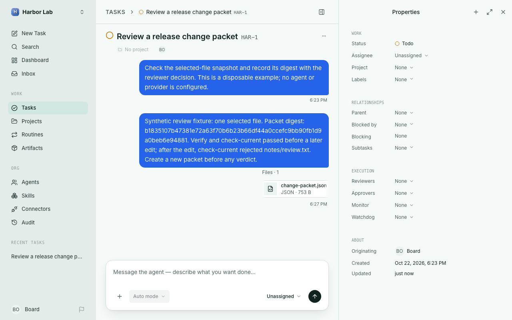

# WorkHarbor

A local desk for agent work and human decisions. Assign tasks, inspect runs and costs, and keep review evidence beside the work it concerns.

WorkHarbor adapts the [Paperclip](https://github.com/paperclipai/paperclip) control plane for an isolated local workspace. Its additions include a loopback-only launcher with separate state, a way to explore before configuring an agent, and a selected-file change-packet helper. Provider adapters are configured separately; opening the workspace does not require an API key.



*Captured from the local app at 1280 × 800. The task and file are disposable examples; no agent or provider ran. The packet is a manual review aid, not an approval.*

## Follow the work

1. Create an organization and choose **Explore workspace first** to inspect the board without setting up an agent.
2. Create a task, then use its thread and properties to inspect the work, status, owner, and review context. Runs and costs appear when configured agents actually execute.
3. For a file review, create a packet containing only the paths you select. Attach it to the task and record its digest separately with the reviewer decision. Check the packet again before that decision; a changed selected file requires a new packet.

The screenshot shows the third step with a synthetic one-file packet. In this capture, `verify` and `check-current` passed initially; after another edit, `check-current` rejected the changed file. [Commands and boundaries](doc/workharbor-change-packets.md) explain how to reproduce that flow. A packet does not automatically approve, publish, deploy, or invalidate a native WorkHarbor decision.

## Local setup

The local launcher supports macOS and Linux from a regular clone or source archive. It rejects linked Git worktrees to avoid loading their separate instance configuration. Windows launcher support is not yet available. The source requires Node.js 24.11 or later, pnpm 9.15.4, and Rust for its native runner. Dependencies are pinned in `pnpm-lock.yaml` and `Cargo.lock`.

```sh
corepack pnpm install --frozen-lockfile
node scripts/workharbor-local.mjs start
```

The launcher uses loopback on port 3180 and keeps application data in `.workharbor/` beside the source. It disables first-party telemetry and announcements, ignores the working-directory `.env`, and does not inherit provider credentials or a database URL from the shell. Configure providers explicitly within this instance.

Scheduled agent runs are off by default. Manual task actions can still invoke configured agents. Use `--schedule` when deliberately enabling scheduled work; internal housekeeping still runs regardless of that flag.

```sh
node scripts/workharbor-local.mjs start --state-dir ./my-workspace --port 3188
node scripts/workharbor-local.mjs stop --state-dir ./my-workspace
```

The stop command targets development services for this checkout in the selected state directory. Application data remain on disk. Do not point this launcher at an existing Paperclip installation's state.

## Verification and limits

The [verification record](doc/workharbor-verification.md) covers local startup, task editing and persistence, save-failure recovery, desktop/mobile resize behavior, build/typecheck, and the configured test partitions, including their explicit skips. Recorded UI checks passed 6,318 assertions. The screenshot above is a fresh no-provider local capture; the packet check described above was reproduced with a disposable file. Neither check demonstrates live provider authentication, agent execution, or hosted operation.

## Development and scope

The core supports company-scoped tasks, agent sessions, budgets, approvals, and persistent run history. Internal package names and API identifiers remain compatible with the base engine. Provider-specific features still require their own configuration and access.

[The implementation plan](doc/plans/2026-09-27-workharbor-adaptation.md) records the implementation scope. Technical architecture and development references remain under `doc/`; descriptions of upstream hosted services are not WorkHarbor hosting offers.

## Source and maintenance

Based on Paperclip v2026.916.1 at `d554c4789ed3930f8a53ac9fdf6503b3187097da`. The inherited engine and technical reference material remain available; upstream package publishing and hosted-deployment scripts are not WorkHarbor release instructions. This repository is distributed as source, not as an upstream npm package. WorkHarbor changes were developed and checked locally before publication; the initial repository snapshot is not a record of the engine’s development timeline.

## License

MIT licensed. [LICENSE](LICENSE) retains the engine copyright; WorkHarbor additions are copyright 2026 nazeeh111. Font and adapter notices remain with their assets.
